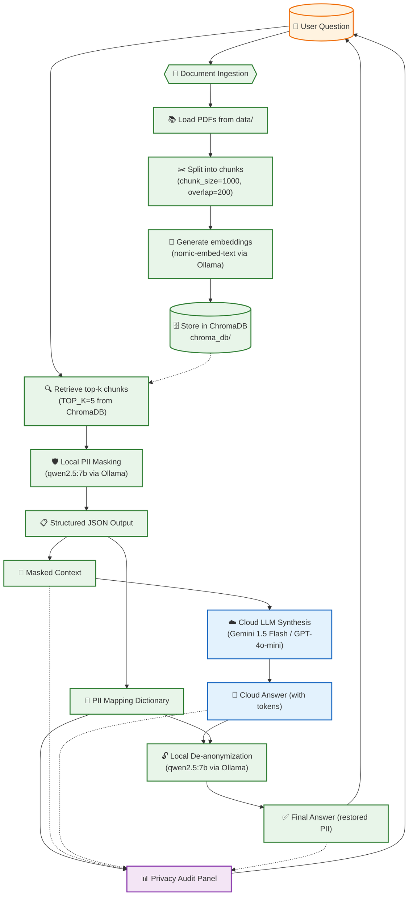

# Privacy-Preserving Agentic RAG - Pipeline Architecture

## Mermaid Flowchart



## Pipeline Stages

### 1. Document Ingestion (Local Only)
| Step | Description | Config |
|------|-------------|--------|
| Load PDFs | Load all PDFs from `data/` directory | `paths.data_dir` |
| Text Splitting | RecursiveCharacterTextSplitter with overlap | `ingestion.chunk_size`, `ingestion.chunk_overlap`, `ingestion.text_splitter_separators` |
| Embeddings | nomic-embed-text via Ollama | `ingestion.embedding_model` |
| Vector Store | ChromaDB persistent storage | `paths.chroma_dir` |

### 2. Query Pipeline

#### Stage A: Local Retrieval
- Retrieve top-k relevant chunks from ChromaDB
- Config: `retrieval.top_k`, `retrieval.embedding_model`

#### Stage B: Local PII Masking (Privacy Critical)
- Local LLM (qwen2.5:7b) identifies PII entities
- Replaces with tokens: `[ENTITY_TYPE_N]`
- Returns masked context + PII mapping
- Config: `models.local_llm_model`, `pii_masking.entity_types`, `pii_masking.token_format`

#### Stage C: Cloud Synthesis
- Sends ONLY masked context to cloud (Gemini/OpenAI)
- Raw PII never leaves local machine
- Config: `models.cloud_llm_model`, `cloud_providers`

#### Stage D: Local De-anonymization
- Local LLM restores original PII from mapping
- Deterministic token replacement
- Config: `models.local_llm_model`

### 3. Privacy Audit
- Shows detected PII, tokens used, models at each step
- Visual confirmation of privacy protection

## Data Flow Guarantees

| Data Type | Location | Cloud Exposure |
|-----------|----------|----------------|
| Raw documents | Local only | ❌ Never |
| Embeddings | Local ChromaDB | ❌ Never |
| Raw PII values | Local only | ❌ Never |
| Masked context | Sent to cloud | ✅ Tokenized only |
| Cloud answer | Received from cloud | ✅ Tokens only |
| Final answer | Local restored | ❌ Never sent |

## Configuration Reference

All configurable parameters are in `config.json` at the project root:

```json
{
  "paths": { "data_dir", "chroma_dir", "src_dir" },
  "ingestion": { "embedding_model", "chunk_size", "chunk_overlap", "text_splitter_separators" },
  "retrieval": { "top_k", "embedding_model" },
  "models": { "local_llm_model", "cloud_llm_model", "embedding_model" },
  "cloud_providers": { "gemini", "openai" },
  "pii_masking": { "entity_types", "token_format", "output_format" },
  "streamlit": { "page_title", "page_icon", "layout", "initial_sidebar_state", "ollama_base_url" }
}
```